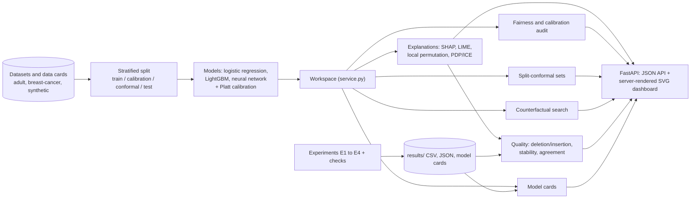

<p align="center"></p>

<p align="center">
  
  
  
</p>

# Explainable AI Prediction Dashboard

> Predictions people can interrogate: explanations, fairness, uncertainty and what-if analysis.

A dashboard that puts a model’s reasoning, fairness profile and uncertainty next to every prediction. It also measures whether the explanations themselves are faithful and stable, because an explanation that changes with the random seed is not an explanation.

**Quick links:** [Architecture](#architecture) · [Tech stack](#tech-stack) · [Results at a glance](#results-at-a-glance) · [Engineering decisions](#engineering-decisions) · [Roadmap](#roadmap) · [Case study](docs/case-study.md) · [Research report](docs/research-report.md)

> **Public showcase.** This repository holds the documentation, client case study, research report and measured results for this product. The runnable source code is distributed separately under a license: see [SOURCE-ACCESS.md](SOURCE-ACCESS.md).

## At a glance

|  |  |
|---|---|
| **Track** | Research · Advanced |
| **Phase** | Beta: milestones M1 to M5 are built and tested, and experiments E1 to E4 have recorded results. The human user study (E5) has **not** been run, so the claim that these displays improve human trust calibration is untested. Not deployed anywhere; the CI workflow has not been executed on GitHub. |
| **Primary reader** | Researchers and technical reviewers |
| **Read next** | [README](README.md) · [Client case study](docs/case-study.md) · [Research report](docs/research-report.md) |

## Why this exists

Stakeholders are asked to trust black-box models, and explanation tools are used as decoration. Nobody checks whether the explanations are faithful to the model, stable across runs, or understood by the people who rely on them. This project builds the tool and measures the first two properties; the third needs a human study that has not been done.

## What it does

Everything below is built and covered by automated tests or by a recorded experiment.

- **Train, serve and compare** three tabular models per dataset: logistic regression (interpretable), LightGBM and a small neural network (black boxes), with Platt-calibrated probabilities. JSON API plus an offline, server-rendered dashboard.
- **Global explanations:** permutation importance, mean absolute SHAP, partial dependence and ICE curves.
- **Local explanations:** SHAP, LIME and a local permutation method for any test row, explaining the model’s log-odds, with a per-row agreement table.
- **Counterfactual what-if:** edit any feature and see the prediction move; a tested greedy search proposes up to three feature-disjoint counterfactuals that respect immutable features, monotone directions, integer features and observed ranges.
- **Subgroup fairness audit:** demographic parity, equalized odds (with TPR and FPR gaps), per-group calibration (ECE) and reliability diagrams, with bootstrap intervals and a pre-stated 0.05 screening tolerance.
- **Uncertainty:** split-conformal prediction sets (marginal or class-conditional) with coverage by class and by group; conformal regression intervals exist in the library.
- **Explanation-quality metrics:** deletion and insertion faithfulness curves against a random-attribution control (live for one row in the dashboard, aggregated in E1), stability across 30 bootstrap refits (E2) and method agreement by correlation stratum (E3).
- **Auto-generated model cards** (Markdown and JSON) for every dataset and model, including measured explanation quality when result files exist; see `results/model_cards/`.
- **Accessible charts:** server-side SVG with a colour-blind-safe palette (Okabe and Ito), dash patterns, marker shapes and fill patterns so colour is never the only cue, a `<title>`/`<desc>` and a data table for every chart, skip link and keyboard-focusable controls. No JavaScript and no external resources.

## Not built yet / out of scope

- **E5 user study (human trust calibration): not run, and H4 is untested.** No human participants were available and none were recruited or simulated. No study harness exists beyond the dashboard pages themselves, and nothing in this repository reports a result about human users.
- Connecting a client’s own model or uploading data: the dashboard serves its bundled benchmark datasets and model zoo only.
- DiCE counterfactuals, MAPIE and PyTorch: replaced by own, tested implementations (counterfactual search, split conformal) and scikit-learn’s neural network, to keep the stack small and verifiable.
- React/Plotly front end and Docker: not built; the dashboard is server-rendered (the Docker daemon was not available in the build environment).
- Multiclass and regression tasks in the dashboard (the library has conformal regression intervals only), drift monitoring, authentication and multi-user state.
- A GitHub Actions workflow exists but **has not been run**; every command in it was run locally.

## Architecture



## Tech stack

| Layer | Technology |
|---|---|
| Language and tooling | Python 3.12, uv (lockfile `uv.lock`) |
| Modelling | scikit-learn (logistic regression, neural network, Platt scaling), LightGBM |
| Explainability | SHAP (closed form, TreeExplainer, permutation explainer), LIME, own local permutation and PDP/ICE, own counterfactual search |
| Fairness and uncertainty | Own tested fairness metrics (cross-checked against Fairlearn in the tests), own split-conformal prediction, own calibration utilities |
| API and dashboard | FastAPI with typed schemas, Jinja2 templates, server-side SVG charts, no JavaScript |
| Quality | pytest, Ruff, mypy (strict), GitHub Actions (written, not executed) |

## Results at a glance

Full tables, sample sizes and confidence intervals are in the [research report](docs/research-report.md); raw data is in `results/` (see [rendered tables](results/report_tables.md)). Data are public benchmarks (Adult/Census 1994 and breast-cancer) and **synthetic** generators, so none of this is a real-world deployment result.

| Experiment | Headline measured result | Verdict |
|---|---|---|
| E1 Faithfulness | SHAP, LIME and local permutation all beat a random ordering on 98% to 100% of instances (deletion gain 0.13 to 0.25); SHAP beats local permutation by only 0.002 to 0.041 | H3 holds in direction and is statistically significant, but the effect is small |
| E2 Stability | For LightGBM, LIME was *more* stable than SHAP on two of three datasets (for example adult: 0.952 versus 0.915); SHAP was clearly more stable only on breast-cancer (0.731 versus 0.514) | H1 not supported as a general claim |
| E3 Agreement | SHAP-LIME top-5 overlap 0.65 to 0.90; no decline with feature correlation across synthetic strata (Spearman -0.005 and -0.051) | H2 not supported |
| E4 Audit | Estimates tracked planted ground truth (oracle DP gap 0.187 versus 0.186 true); the 0.05 tolerance flagged the oracle's bias in 100% of replicates but only 3% to 13% for group-blind models that inherit about 0.05 to 0.06 | Audit estimates validated; screening threshold too coarse; false-alarm rate 0% |
| E5 User study | not run | H4 untested |

## Engineering decisions

### Explanations are measured, not assumed

Each explanation method is scored for faithfulness, stability and agreement, and the dashboard shows a live deletion/insertion check for the selected row next to the aggregate results. The experiments found that the "obvious" ranking of methods does not always hold, which is the argument for measuring.

### Fairness and uncertainty live beside accuracy

They are core pages, not an appendix. A model with good aggregate accuracy and a large subgroup gap, or marginal conformal coverage that hides a poorly covered class, is shown as such.

### Public and synthetic data, labelled

Development uses published benchmark data whose historical bias is documented in a data card, plus synthetic data with a planted, known bias so the audit can be validated against ground truth. Synthetic data is always labelled as synthetic, and the sensitive attribute is used for audit only, never as a model input.

### Honest statistics

Per-cell sample sizes, seeds and hardware are recorded; negative results are reported as negative; one-sided tests are Holm-adjusted within pre-stated families; and "significant but trivial" is called trivial.

## Quality bar

- Unit tests validate explanation utilities against analytically known cases: closed-form linear SHAP, the SHAP library cross-check, tree-SHAP additivity, local permutation equal to linear SHAP, permutation importance against its analytic value, and parallel ICE curves for a linear model.
- Fairness metrics are checked on hand-computed examples and against Fairlearn; conformal quantiles on hand examples and coverage on exchangeable simulations; counterfactual search against the analytic decision boundary of a linear model.
- A stability test across bootstrap refits has recorded thresholds (logistic regression above 0.85, LightGBM above 0.70; measured 0.96 and 0.87 when set).
- Model cards are generated for every trained model and contain relative paths only.
- Accessible visualisations are tested: palette membership, `role="img"` with title and description, and a data table for every chart.
- Ruff, mypy strict and pytest all pass locally (106 tests, run both in this folder and in a clean copy installed from the lockfile at a short path).

## Roadmap

- [x] M1: train, evaluate and serve baseline models
- [x] M2: global and local explanations in the dashboard
- [x] M3: fairness audit and calibration panels
- [x] M4: conformal intervals (prediction sets) and counterfactual what-if tool
- [x] M5: explanation-quality metrics and model cards (the user study is **not** part of this milestone and has not been run)
- [ ] E5 user study: not started (needs human participants and ethics review)

## Getting started

> _These instructions refer to the source package, which is distributed separately and is not part of this showcase repository._

Requirements: Windows, macOS or Linux with [uv](https://docs.astral.sh/uv/) installed. Python 3.12 is installed by uv from the `.python-version` file. Use a short checkout path on Windows: deep folders can break native packages through the path-length limit.

```
uv sync
uv run python -m xaidash
```

Then open `http://127.0.0.1:8000` (set `XAI_HOST` and `XAI_PORT` to change the address; see `.env.example`). The first request for a dataset trains its three models, which takes tens of seconds on a busy machine. The Adult dataset is downloaded once from OpenML into the git-ignored `data/` folder; if the download is unavailable the dashboard still serves the breast-cancer and synthetic data.

To regenerate every result (about 70 minutes on two busy cores; writes to `results/`):

```
uv run python -m experiments.run_all
uv run python -m experiments.report_tables
```

Troubleshooting: if Python HTTPS calls abort with an `OPENSSL_Applink` error on Windows, clear the `SSLKEYLOGFILE` environment variable in that shell. The project caps BLAS and OpenMP threads at 2 (`XAI_MAX_THREADS`).

## Verification

> _These instructions refer to the source package, which is distributed separately and is not part of this showcase repository._

```
uv run pytest
uv run ruff check .
uv run ruff format --check .
uv run mypy
```

`.github/workflows/ci.yml` runs the same commands plus a tiny end-to-end experiment smoke run, but it has not been executed on GitHub. A smoke run of the experiment pipeline locally: `XAI_RESULTS_DIR=.tmp/smoke uv run python -m experiments.run_all --smoke`.

## Repository layout

> _These instructions refer to the source package, which is distributed separately and is not part of this showcase repository._

- `xaidash/`: library and application (`data.py`, `models.py`, `explain.py`, `quality.py`, `fairness.py`, `conformal.py`, `counterfactual.py`, `modelcard.py`, `service.py`, `app.py`, `viz.py`, `templates/`)
- `experiments/`: one module per experiment (`e1` to `e4`, `checks`, `model_cards`), `run_all`, `report_tables`
- `tests/`: pytest suite (data, models, explanations, fairness, conformal, counterfactual, quality, model cards, API and accessibility, experiments, repository hygiene)
- `results/`: raw and summary CSV/JSON, logs, rendered tables and model cards produced by the experiments
- `docs/`: case study and research report
- `pyproject.toml`, `uv.lock`, `.python-version`, `.env.example`, `.github/workflows/ci.yml`

## Skills demonstrated

`Interpretable ML` · `Fairness and bias auditing` · `Uncertainty quantification` · `Data-visualization design` · `Experimental design and honest statistics` · `Responsible-AI documentation`

## One project, three lenses

The same project is documented for three audiences, so one body of work serves every goal.

| If you are… | Read | You will find |
|---|---|---|
| Hiring or reviewing engineers | [This README](README.md) | Architecture, trade-offs, quality bar and what I would defend in a design review |
| A client or founder | [Client case study](docs/case-study.md) | The business problem, the value levers, how it is measured and how an engagement runs |
| A researcher or technical reviewer | [Research report](docs/research-report.md) | Hypotheses, methods, statistical plan, recorded results for E1 to E4, and the reproducibility checklist |

## Author

Built by **[The Diamond Empire](https://thedempire.shop/)**.
